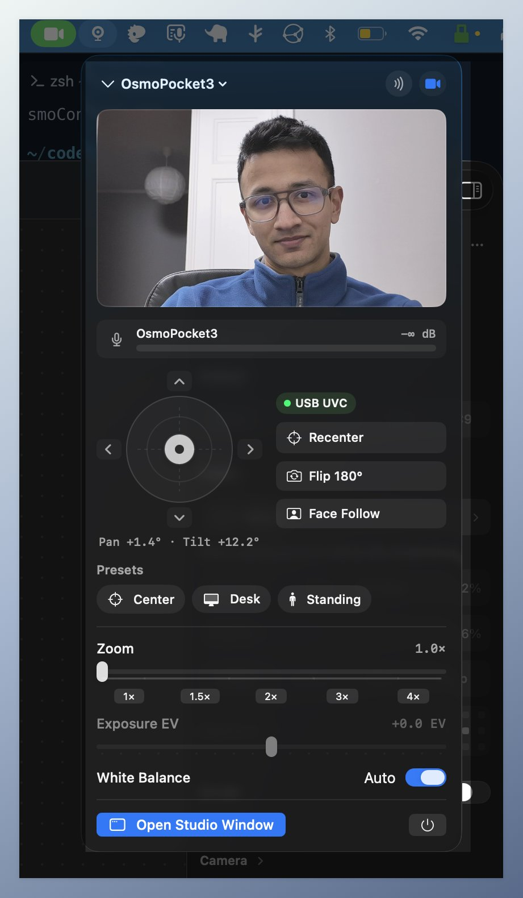

# OsmoBar

Native SwiftUI macOS menu bar app + floating Studio Window for controlling a **DJI Osmo Pocket 3** while using it in **Webcam (UVC)** mode.

<p align="center">
  
</p>

## Features

- **Menu Bar Popover & Pop-out Studio Window**: Quick controls right in your macOS menu bar plus a resizable, optional "Always on Top" Studio Window.
- **Live Video Preview & Audio Meter**: Built-in AVFoundation preview (with Mirror & Rule-of-Thirds grid toggles) and a real-time USB audio VU meter with peak hold and dB readout.
- **Smooth Gimbal Steering & Presets**: Drag the 2D virtual joystick pad, nudge with arrow keys, **Recenter**, **Flip 180°** over USB, and save/recall angle presets.
- **Vision Face Follow**: Real-time macOS Vision (`VNDetectFaceRectanglesRequest`) face tracking over USB UVC with a live tracking reticle.
- **Image & Exposure Controls**: Hardware UVC Zoom (`1×`–`4×`), Exposure, White Balance (Auto / Kelvin), Brightness, Contrast, Saturation, Sharpness, Gain, plus optional Pocket 3 Pro DUML settings (EV, ISO, Shutter, Color Profile, Product Showcase).

## Transports

Inspired by [`datagutt/node-osmo`](https://github.com/datagutt/node-osmo) and Pocket 3 DUML reverse-engineering research, **OsmoBar** unifies three transports alongside FaceTime, Zoom, Google Meet, or OBS:

1. **USB UVC Control Plane (`IOKit` pipe 0)** — Works concurrently over USB-C without stealing the webcam stream (Pan/Tilt, Flip 180°, Recenter, Zoom, and supported UVC image controls).
2. **Bluetooth LE DUML (`CoreBluetooth` — `FFF0` / `FFF4` / `FFF5`)** — Streams live Battery % + charging state (`0D/02`) and Gimbal Pitch/Roll/Yaw telemetry (`04/05`), and can wake the Pocket 3 Wi-Fi AP (`53/10`).
3. **Optional Direct Pocket 3 Wi-Fi Datalink (`192.168.2.1:9004`)** — Unlocks full DUML `02/*` Pro camera controls, `00/99` readback, and hardware `04/4C` gimbal lock.

## Build & Run

```bash
# Run unit tests (CRC8/CRC16, DUML framing, Pocket 3 vectors, UVC descriptor & PTZ)
swift test

# Build and package OsmoBar.app
chmod +x scripts/build-app.sh
./scripts/build-app.sh

# Launch OsmoBar
open build/OsmoBar.app
```
